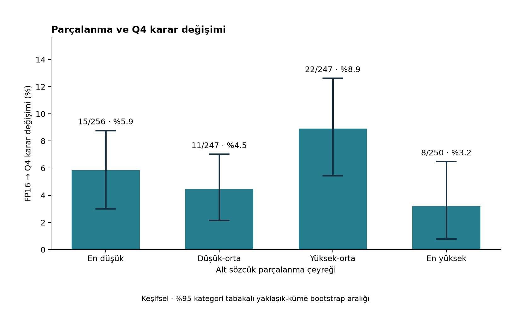

# Alt sözcük parçalanması ve Q4 duyarlılığı — keşifsel ek analiz

## Kapsam ve yöntem

Ana deneyden sonra tasarlanan bu analiz, önceden belirlenmiş doğrulayıcı bir hipotez testi değildir. Mevcut 1.000 minimal çift ve üç modelin kayıtları pair_id üzerinden birleştirildi. Eksik/tekrarlı kimlik, kategori, karar, veri hash’i veya token uyumsuzluğunda işlem durur. Hiçbir model yüklenmedi; puanlama tekrarlanmadı.

Sözcükler Unicode harf/sayı dizileridir; sözcük içi düz/kıvrık kesme korunur, tire ayırır, bağımsız noktalama sayılmaz. Sayılar sözcük birimi sayılır. Kayıtlı n_tokens BOS ve EOS içermez; ayrıca 1 çıkarılmadı. Noktalama tokenları mevcut deney sayısında bulunduğundan payda sözcük saymazken pay bunları içerir. Bu nedenle ölçüt saf sözcük-içi parçalanma veya morfem/ek sayısı değildir; cümle düzeyinde token/sözcük yoğunluğu vekilidir.

Ana ölçüt doğru ve hatalı cümlenin token/sözcük oranlarının aritmetik ortalamasıdır. İşaretli fark doğru−hatalı olarak, mutlak fark ayrıca saklandı. Uzunluk kontrolü iki cümlenin ortalama sözcük sayısıdır. FP16 marjı ortalama log-olasılık(doğru)−ortalama log-olasılık(hatalı) olup mutlak değeri kullanıldı.

Çeyrek eşikleri: 1.857143, 2.083333, 2.339286. Sınırlardaki eşit değerler alt grupta tutuldu; gruplar bu nedenle tam 250 olmayabilir. Kategori tablolarında aynı genel eşikler kullanıldı; kategori-içi çeyrekler de JSON ve CSV’de sunuldu.

Düzenlileştirilmiş lojistik regresyonun sonucu flip_q4’tür. Amaç fonksiyonu toplam negatif log-olabilirlik + λ/2 × eğimlerin kareleri toplamıdır; sabit terim cezalandırılmaz. Ana λ=1; λ=0,1 ve 10 duyarlılıkları ayrıca hesaplandı. Sürekli değişkenler ve kategori kuklaları standartlaştırıldı. Ana model parçalanma, mutlak FP16 marjı, ortalama sözcük sayısı ve kategori içerir. OR, karar değişiminin odds oranıdır; risk oranı veya nedensel etki değildir.

Her yeniden örnekleme türünde 2,000 tekrar, sabit tohum 20261029 kullanıldı. Minimal çift bütünlüğü korunarak kategori tabakalı çift bootstrap yapıldı. İkinci analiz mevcut 776 yaklaşık şablon kümesini kategori içinde bütün olarak yeniden örnekledi; kategori ağırlıkları başlangıç boyutuna normalize edildi. Her tekrarda ölçekleme ve regresyon yeniden kuruldu, OR özgün örneklem standart sapmasına çevrildi. %95 yüzdelik aralıklar düzenlileştirilmiş tahminin belirsizliğini gösterir; düzenlileştirme yanlılığını gidermez. Her iki türde başarısız tekrar sayısı 0’dır.

## Sonuçlar

| Grup | n | FP16 % | Q4 % | Doğru→yanlış n (%) | Yanlış→doğru n (%) | Değişim n (%) |
|---|---:|---:|---:|---:|---:|---:|
| Tümü | 1000 | 91.20 | 88.40 | 42 (4.20) | 14 (1.40) | 56 (5.60) |

| Grup | n | FP16 % | Q4 % | Doğru→yanlış n (%) | Yanlış→doğru n (%) | Değişim n (%) |
|---|---:|---:|---:|---:|---:|---:|
| 1 | 256 | 91.02 | 86.72 | 13 (5.08) | 2 (0.78) | 15 (5.86) |
| 2 | 247 | 93.52 | 91.50 | 8 (3.24) | 3 (1.21) | 11 (4.45) |
| 3 | 247 | 88.66 | 87.04 | 13 (5.26) | 9 (3.64) | 22 (8.91) |
| 4 | 250 | 91.60 | 88.40 | 8 (3.20) | 0 (0.00) | 8 (3.20) |

Q8: 3 karar değişimi; yalnızca tanımlayıcıdır. Genel Q8 doğruluğu %91.50. Kategori ve çeyrek ayrıntıları JSON’dadır.

| Model | Parçalanma OR / 1 SS | Çift bootstrap %95 GA | Küme bootstrap %95 GA |
|---|---:|---|---|
| Kontrolsüz | 0.789 | [0.611, 0.982] | [0.592, 1.027] |
| Marj + kategori + sözcük uzunluğu kontrollü | 0.735 | [0.548, 0.932] | [0.540, 0.946] |

Bir standart sapma = 0.3977 token/sözcük. En yüksek−en düşük çeyrek karar değişimi farkı -2.66 yüzde puan; küme bootstrap %95 GA [-6.5, 1.41] yüzde puandır.

## Kategori karşılaştırmaları

### argument_structure_transitive

| Grup | n | FP16 % | Q4 % | Doğru→yanlış n (%) | Yanlış→doğru n (%) | Değişim n (%) |
|---|---:|---:|---:|---:|---:|---:|
| 1 | 59 | 94.92 | 93.22 | 1 (1.69) | 0 (0.00) | 1 (1.69) |
| 2 | 63 | 93.65 | 92.06 | 2 (3.17) | 1 (1.59) | 3 (4.76) |
| 3 | 61 | 91.80 | 91.80 | 1 (1.64) | 1 (1.64) | 2 (3.28) |
| 4 | 67 | 92.54 | 89.55 | 2 (2.99) | 0 (0.00) | 2 (2.99) |

### irregular_forms

| Grup | n | FP16 % | Q4 % | Doğru→yanlış n (%) | Yanlış→doğru n (%) | Değişim n (%) |
|---|---:|---:|---:|---:|---:|---:|
| 1 | 53 | 100.00 | 100.00 | 0 (0.00) | 0 (0.00) | 0 (0.00) |
| 2 | 86 | 97.67 | 98.84 | 0 (0.00) | 1 (1.16) | 1 (1.16) |
| 3 | 73 | 100.00 | 100.00 | 0 (0.00) | 0 (0.00) | 0 (0.00) |
| 4 | 38 | 100.00 | 100.00 | 0 (0.00) | 0 (0.00) | 0 (0.00) |

### nominalization

| Grup | n | FP16 % | Q4 % | Doğru→yanlış n (%) | Yanlış→doğru n (%) | Değişim n (%) |
|---|---:|---:|---:|---:|---:|---:|
| 1 | 61 | 90.16 | 88.52 | 1 (1.64) | 0 (0.00) | 1 (1.64) |
| 2 | 55 | 90.91 | 87.27 | 3 (5.45) | 1 (1.82) | 4 (7.27) |
| 3 | 66 | 77.27 | 80.30 | 3 (4.55) | 5 (7.58) | 8 (12.12) |
| 4 | 68 | 79.41 | 70.59 | 6 (8.82) | 0 (0.00) | 6 (8.82) |

### subject_agreement

| Grup | n | FP16 % | Q4 % | Doğru→yanlış n (%) | Yanlış→doğru n (%) | Değişim n (%) |
|---|---:|---:|---:|---:|---:|---:|
| 1 | 83 | 83.13 | 72.29 | 11 (13.25) | 2 (2.41) | 13 (15.66) |
| 2 | 43 | 88.37 | 81.40 | 3 (6.98) | 0 (0.00) | 3 (6.98) |
| 3 | 47 | 82.98 | 70.21 | 9 (19.15) | 3 (6.38) | 12 (25.53) |
| 4 | 77 | 97.40 | 97.40 | 0 (0.00) | 0 (0.00) | 0 (0.00) |

## Duyarlılık analizleri

| Değişiklik | Parçalanma OR / 1 SS | Küme bootstrap %95 GA |
|---|---:|---|
| token_length | 0.900 | [0.649, 1.230] |
| difference_control | 0.742 | [0.544, 0.952] |
| log_margin | 0.737 | [0.546, 0.953] |
| λ=0.1 | 0.716 | Hesaplanmadı |
| λ=10.0 | 0.817 | Hesaplanmadı |
| argument_structure_transitive dışarıda | 0.747 | Hesaplanmadı |
| irregular_forms dışarıda | 0.737 | Hesaplanmadı |
| nominalization dışarıda | 0.668 | Hesaplanmadı |
| subject_agreement dışarıda | 0.749 | Hesaplanmadı |

## Yorum ve sınırlılıklar

Kontrollerden sonra negatif ilişki küme bootstrap aralığında da korunuyor.

Daha yüksek parçalanmanın daha fazla Q4 karar değişimiyle ilişkili olduğu beklentisi desteklenmedi. Çeyreklerde düzenli bir artış/azalış yoktur; en yüksek ve en düşük çeyrek farkının küme aralığı sıfırı içerir. Regresyonun ortak doğrusal log-odds eğimi bu düzensiz dağılımı özetler; kategori etkileşimlerini veya doğrusal olmayan ilişkiyi kanıtlamaz. Token uzunluğu kontrolünde etkinin zayıflaması nedeniyle negatif eğilim de yöntemden bağımsız, koruyucu bir etki olarak yorumlanmamalıdır. Kategori çıkarma tahminlerinin tümü aynı yöndedir; bu tek kategori açıklamasına karşı bir duyarlılık bulgusudur, alt grup ilişkilerinin eşitliğinin kanıtı değildir.

Ceza katsayısı ve kategori çıkarma duyarlılıkları için yalnızca nokta tahminleri verildi; bunlar ayrı anlamlılık iddiaları değildir. Log-marj kontrolü log(|marj|+0,0001) kullanır. Kategori çıkarma analizleri tek bir kategorinin etkisini inceler, fakat alt grup olay sayıları sınırlıdır. Bozulma ve iyileşme ayrı tanımlayıcı sonuçlardır; ana regresyon toplam karar değişimini açıklar, doğrudan doğruluk kaybını açıklamaz.

Yaklaşık kümeler önceki analizde ortak baştaki söylem/zaman sözcüklerinin çıkarılmasıyla oluşturulmuştur; gerçek üretim şablonları değildir. Bootstrap bu kümelerin ötesindeki bağımlılığı gideremez. FP16 marjının fonksiyonel biçimi, uzunluk ile oran arasındaki matematiksel ilişki, noktalama katkısı ve sözcük tanımı sonuçları etkileyebilir. Bu gözlemsel analiz nedensellik göstermez ve tüm Türkçeye genellenemez. Çok sayıda keşifsel karşılaştırma için p-değerleri üretilmedi; aralıklar çoklu karşılaştırma için düzeltilmedi.

Tartışmalı etiketlerin bağımsız uzmanlarca kör incelenmesi ve gerçek üretim şablonlarının doğrulanması sonraki işlerdir; bu analiz bunları tamamlamış sayılmaz. Makale yazımı bu teslimatın kapsamına alınmadı.

## Yeniden üretim ve koruma

`.venv/bin/python scripts/analyze_fragmentation.py --bootstrap 2000`

Girdi SHA-256 değerleri, sürümler, katsayılar, ölçekler ve bootstrap ayrıntıları fragmentation_statistics.json içindedir. Çalışma öncesi/sonrası 300 mevcut dosyanın hash’i karşılaştırıldı: değişiklik yok. Ana deney ve eski istatistik dosyaları korunmuştur.

Yöntem kaynakları: [SciPy bootstrap](https://docs.scipy.org/doc/scipy/reference/generated/scipy.stats.bootstrap.html), [SciPy minimize](https://docs.scipy.org/doc/scipy/reference/generated/scipy.optimize.minimize.html).

